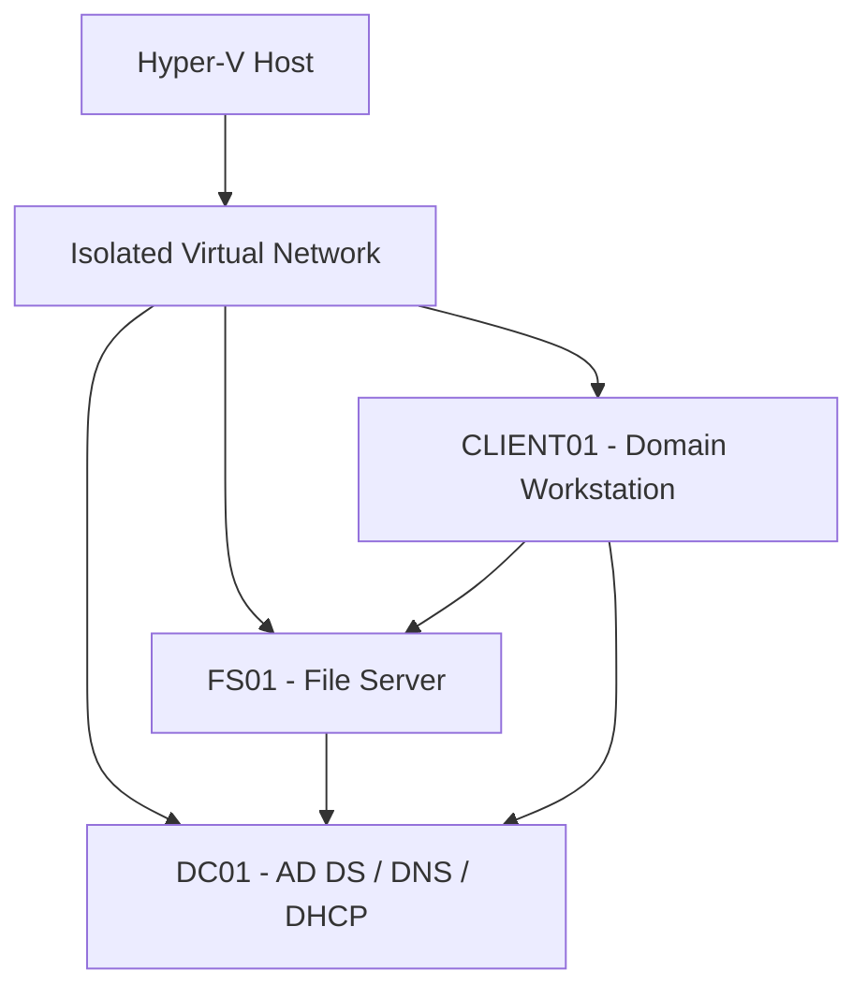

# Windows Server 2022 | Active Directory Administration Lab

**[View the published screenshot evidence gallery](docs/published-evidence-gallery.md)** — 9 screenshots with evidence limitations.

[Published screenshot privacy and integrity review](docs/privacy-and-integrity-review.md) — file hash verification, privacy findings, and historical Git limitations.

A hands-on systems administration lab built with **Hyper-V** and **Windows Server 2022**, simulating a small corporate environment. This portfolio documents identity management, networking, Group Policy, file services, access control, PowerShell automation, and recorded recovery exercises.

## Architecture

## Environment

| Component | Implementation |
| --- | --- |
| Virtualization | Microsoft Hyper-V |
| Servers | Windows Server 2022 |
| Identity | Active Directory Domain Services |
| Domain | `corp.northstarlab.test` (simulated) |
| Domain controller | DC01 |
| Member file server | FS01 |
| Test workstation | CLIENT01 |
| Departments | IT, HR, Finance, Operations |
| Network services | DNS, DHCP, isolated virtual networking |

Specific private lab addressing and configuration details are documented in the [architecture notes](docs/architecture.md), rather than on this landing page.

## Hands-on work

- **Active Directory:** Domain deployment, departmental organizational units, users, security groups, and account policies.
- **DNS and DHCP:** Name resolution, forwarders, address allocation, and network validation.
- **Group Policy:** Workstation baseline and department-specific drive mapping.
- **File services:** SMB shares, share and NTFS permissions, group-based access using an AGDLP-style approach, and authorized/unauthorized access tests.
- **Backup and recovery:** Windows Server Backup initiation is visible in the published evidence. Historical notes describe an alternate-location AD installation-media restore and AD Recycle Bin exercise; completion evidence is not yet published. The displayed test account is not locked out.
- **PowerShell:** Historical notes describe onboarding, offboarding, and CSV reporting. The original working scripts and execution logs are not published; the available script screenshot does not demonstrate a completed script.

## Technical documentation

| Document | What's covered |
| --- | --- |
| [Architecture](docs/architecture.md) | Hyper-V topology, domain services, network design, and configuration |
| [File server and permissions](docs/file-server-and-permissions.md) | FS01, departmental shares, NTFS/SMB permissions, and access validation |
| [PowerShell automation](docs/powershell-automation.md) | User lifecycle workflows, reporting, and validation |
| [Backup and recovery](docs/backup-and-recovery.md) | Backup protection, AD recovery exercises, and lockout tests |
| [Evidence review](docs/evidence-review.md) | Screenshot-by-screenshot verification, limitations, and publication safeguards |
| [Script evidence audit](docs/script-evidence-audit.md) | Original screenshot references, verified command results, and unverified automation claims |

## Script examples

- [Get-LabOrganizationalUnits.ps1](scripts/Get-LabOrganizationalUnits.ps1) — a read-only example for reporting Active Directory organizational units. This published version has **not been independently verified as executed** in the lab.

## Evidence and scope

This is a personal test environment, not a production deployment. Nine curated screenshots are published in the [current evidence gallery](docs/published-evidence-gallery.md). An [older eight-image gallery](docs/screenshot-gallery.md) remains available for historical reference; some images overlap. Captions distinguish observed outcomes from unverified work.

**Next improvements:** Validate and publish the original automation scripts, capture completed backup and restore results, and document repeatable validation commands.

## Security

This repository represents a simulated environment. Do not publish employer or customer information, passwords, tokens, BitLocker or LAPS recovery material, or other confidential data.

## Additional technical documentation

- [Domain controller validation and troubleshooting](docs/validation-and-troubleshooting.md) — health checks, Group Policy validation, and recovery limitations

## Related administration labs

- [Microsoft Entra ID & Intune Device Security Lab](https://github.com/KaaninGibson/Microsoft-Entra-Intune-Lab) — endpoint enrollment, compliance, BitLocker policy, Windows LAPS, and Conditional Access report-only evaluation.
- [Azure Infrastructure Administration Lab](https://github.com/KaaninGibson/Azure-Infrastructure-Lab) — virtual networking, compute, storage, governance, monitoring, and cleanup exercises.
