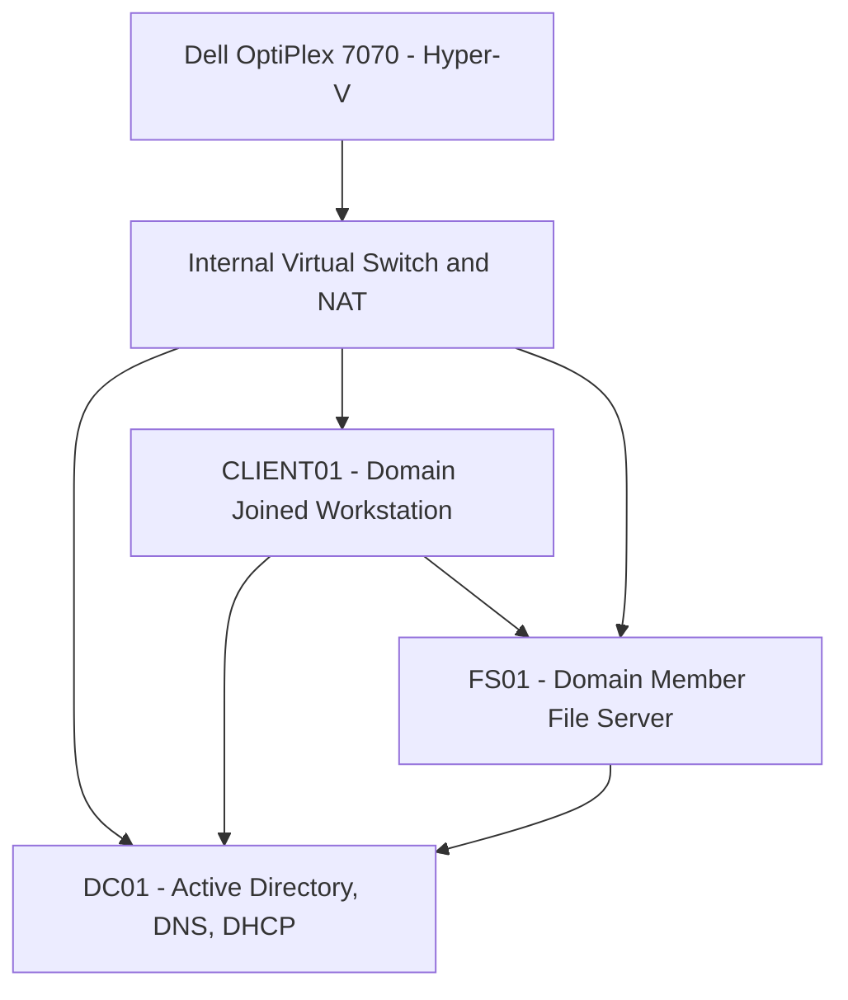

# Windows Server Lab Architecture

## Overview

This project documents an isolated Windows Server 2022 administration lab built with Hyper-V on a Dell OptiPlex 7070.

The lab demonstrates Active Directory Domain Services, DNS, DHCP, Group Policy, file services, access controls, PowerShell automation, and backup and recovery.

## Network Architecture

## Lab Environment

| Component | Configuration |
| --- | --- |
| Hypervisor | Microsoft Hyper-V |
| Host | Dell OptiPlex 7070 |
| Server OS | Windows Server 2022 |
| Domain | corp.northstarlab.test |
| NetBIOS | NORTHSTAR |
| Network | 10.50.10.0/24 |
| Domain Controller | DC01 |
| File Server | FS01 |
| Workstation | CLIENT01 |
| DNS Forwarders | 1.1.1.1 and 8.8.8.8 |

## Active Directory Configuration

- Deployed Active Directory Domain Services on DC01.
- Created organizational units for IT, HR, Finance, and Operations.
- Configured test users and security groups.
- Implemented password complexity and account lockout policies.
- Applied and validated a workstation security baseline using Group Policy.
- Enabled Active Directory Recycle Bin and tested deleted-object recovery.

## DNS and DHCP

- Configured DNS forwarders and a reverse lookup zone.
- Validated internal and external name resolution.
- Configured DHCP with appropriate gateway and DNS options.
- Used an isolated Hyper-V virtual network with NAT.

## FS01 File Server

FS01 was deployed as a domain-joined member server.

Completed tasks included:

- Configured departmental file shares for IT, HR, Finance, and Operations.
- Implemented share-level and NTFS permissions.
- Applied AGDLP-style group-based access control.
- Configured departmental drive mappings through Group Policy Preferences.
- Tested authorized and unauthorized file access from the domain-joined workstation.

## Group Policy

The workstation security baseline included:

- 15-minute inactivity timeout.
- Hiding the previously signed-in username.
- Disabling Windows consumer experiences.

Group Policy application was validated from the client.

## Backup and Recovery

- Configured Windows Server Backup for system-state protection.
- Performed an alternate-location Active Directory installation-media restore test.
- Tested recovery of deleted Active Directory objects using Active Directory Recycle Bin.
- Validated account lockout behavior.

## PowerShell Automation

Created and tested PowerShell workflows for:

- Active Directory user onboarding.
- Standardized account attributes and OU placement.
- Security group membership assignment.
- Account offboarding and disablement.
- CSV audit output.

## Future Improvements

- Deploy a second domain controller for redundancy.
- Implement centralized monitoring and logging.
- Expand automated configuration and validation scripts.
- Document recovery objectives and perform additional restore testing.

## Documentation

The completed work is based on the September 2026 sanitized technical portfolio report. Current virtual machine state and exact configuration details should be revalidated before publishing live command output or screenshots.
