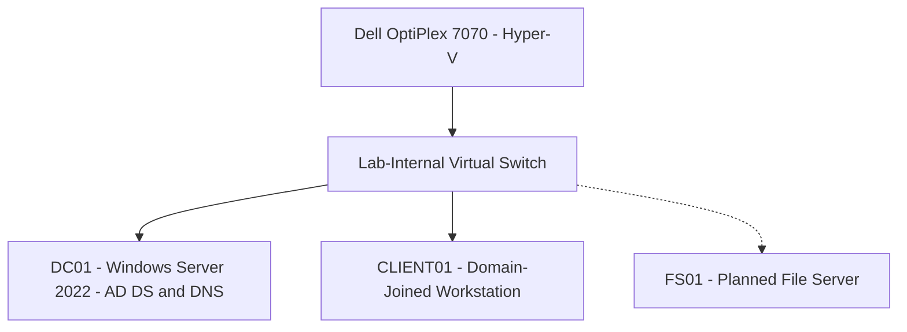

# Lab Architecture

## Overview

This lab simulates a small Windows-based corporate environment using Hyper-V on a Dell OptiPlex 7070.

## Network Diagram

## Domain Configuration

| Setting | Value |
|---|---|
| Domain | corp.northstarlab.test |
| NetBIOS | NORTHSTAR |
| Domain Controller | DC01 |
| Network | 10.50.10.0/24 |
| DNS Forwarders | 1.1.1.1, 8.8.8.8 |

## Implemented Components

- Windows Server 2022 domain controller
- Active Directory Domain Services
- DNS and external forwarding
- Departmental organizational units
- Domain-joined client workstation
- Workstation security baseline Group Policy
- Active Directory Recycle Bin

## Planned Improvements

- Deploy FS01 as a file server.
- Configure SMB shares and NTFS permissions.
- Implement AGDLP-based group permissions.
- Validate DNS and DFSR health.
- Document administrative PowerShell scripts.

## Notes

This diagram represents a simulated lab environment. FS01 is planned and has not been deployed.
