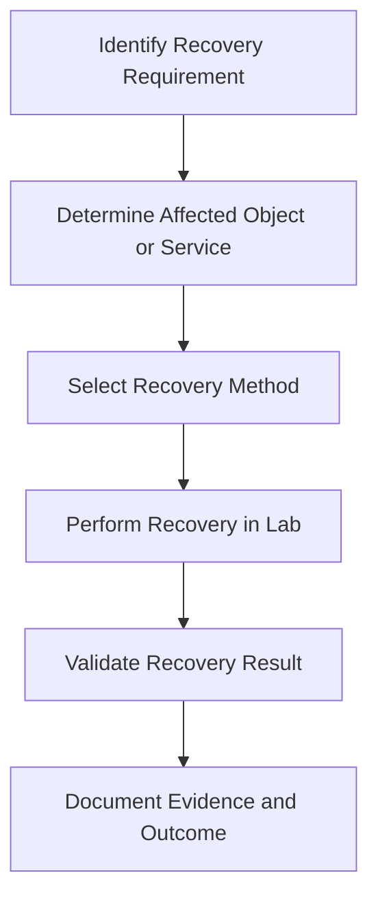

# Windows Server Backup and Active Directory Recovery

## Overview

This document describes backup and recovery exercises completed in an isolated Windows Server 2022 Active Directory lab.

The objective was to practice protecting directory services, recovering deleted objects, and validating account security controls.

## Lab Environment

| Component | Description |
| --- | --- |
| Domain Controller | DC01 |
| Domain | corp.northstarlab.test |
| Operating System | Windows Server 2022 |
| Backup Tool | Windows Server Backup |
| Directory Recovery | Active Directory Recycle Bin |

## Windows Server Backup

Windows Server Backup was configured for system-state protection.

System-state backup is important for protecting Active Directory Domain Services and related Windows Server configuration.

### Documented Work

- Configured Windows Server Backup.
- Prepared system-state protection.
- Completed an alternate-location Active Directory installation-media restore test.
- Recorded backup and restore validation evidence.

### Recovery Scope

The documented restore test used an alternate location for Active Directory installation media.

This should not be confused with a complete domain-controller disaster recovery or full authoritative Active Directory restoration.

## Active Directory Recycle Bin

Active Directory Recycle Bin was enabled to support recovery of accidentally deleted directory objects.

### Documented Test

- Enabled Active Directory Recycle Bin.
- Deleted a test directory object.
- Recovered the deleted object.
- Verified the recovery result.

## Account Lockout Testing

The lab included account lockout configuration and validation.

The documented password and lockout settings included:

| Setting | Configured Value |
| --- | --- |
| Minimum password length | 12 characters |
| Password history | 24 passwords |
| Maximum password age | 90 days |
| Account lockout threshold | 5 failed attempts |
| Lockout duration | 15 minutes |
| Lockout counter reset | 15 minutes |

## Recovery Workflow

This diagram represents a general recovery workflow, not an exact transcript of the original commands.

## Validation Summary

| Test | Recorded Outcome |
| --- | --- |
| Windows Server Backup configuration | Backup feature installed; backup start captured |
| Alternate-location AD installation-media restore | Completed |
| Active Directory Recycle Bin recovery | Completed |
| Account lockout testing | Test user shown with `LockedOut: False`; successful lockout not shown |

The restore and Recycle Bin rows reflect historical notes, not independently verified screenshots in the published gallery. The screenshot of `wbadmin` shows a backup **starting**, not completion.

## Skills Demonstrated

- Windows Server Backup administration.
- Active Directory recovery.
- System-state protection concepts.
- Deleted-object restoration.
- Password and account lockout policy administration.
- Recovery validation and documentation.

## Future Improvements

- Test full domain-controller recovery in an isolated environment.
- Document recovery point and recovery time objectives.
- Add scheduled backup monitoring.
- Perform recurring restore verification.
- Capture sanitized backup and recovery command output.

## Documentation Note

This document records historical lab exercises. It does not claim that a full domain-controller disaster recovery was performed or that current backup jobs have been revalidated.
