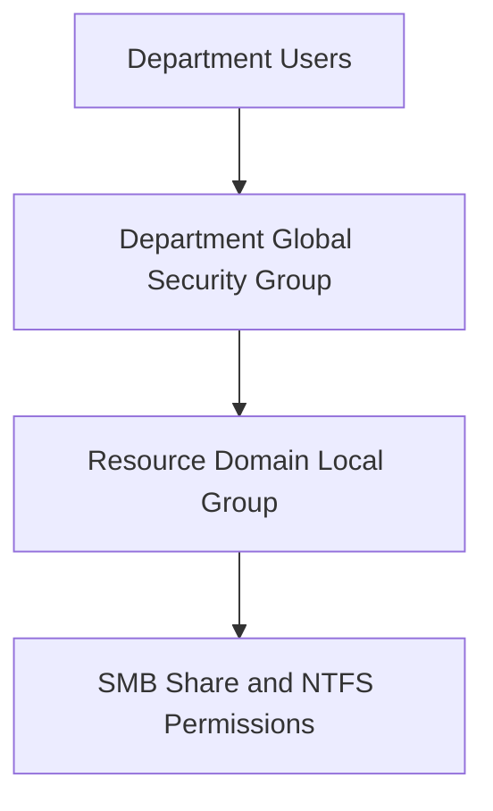

# FS01 File Server and Permissions

## Project Overview

This document covers the deployment, configuration, and validation of departmental file services in an isolated Windows Server 2022 Active Directory lab.

The objective was to provide centralized storage while enforcing least-privilege access through Active Directory security groups, SMB share permissions, NTFS permissions, and Group Policy drive mappings.

## Lab Environment

| Component | Role |
| --- | --- |
| DC01 | Active Directory, DNS, DHCP, Group Policy |
| FS01 | Domain-joined Windows Server file server |
| CLIENT01 | Domain-joined Windows workstation |
| Domain | corp.northstarlab.test |
| Hypervisor | Microsoft Hyper-V |
| Network | 10.50.10.0/24 |

## FS01 Deployment

FS01 was configured as a member server in the NORTHSTAR Active Directory domain.

The file server provided shared departmental storage and used centralized domain authentication and authorization.

## Departmental File Shares

The lab included file shares for four departments:

| Department | Purpose |
| --- | --- |
| IT | Departmental IT storage |
| Human Resources | HR departmental storage |
| Finance | Finance departmental storage |
| Operations | Operations departmental storage |

The exact SMB share names, UNC paths, and underlying disk layout are not reproduced here because they have not been independently recovered from the original configuration logs.

## Active Directory Group-Based Access

Access was organized using an AGDLP-style model:

- A: Accounts representing departmental users.
- G: Global security groups containing department members.
- DL: Domain-local security groups representing resource permissions.
- P: Permissions assigned to the domain-local groups.

### Authorization Model

This structure separates user membership from resource permissions and simplifies administration when employees join, leave, or change departments.

## SMB and NTFS Permissions

Departmental shares were configured with group-based access controls.

The implementation included:

- Share-level permissions.
- NTFS file system permissions.
- Department-based security groups.
- Authorized and unauthorized access testing.

The historical portfolio confirms that group-based access was tested successfully. Exact access control entries and permission levels should be documented separately when original configuration evidence is available.

## Group Policy Drive Mapping

Group Policy Preferences was used to map departmental storage to the domain-joined Windows client.

This allowed mapped drives to be managed centrally instead of requiring users to configure network paths manually.

## Access Validation

The lab included validation from the Windows client.

| Validation Area | Recorded Result |
| --- | --- |
| Domain authentication | Validated |
| Departmental drive mapping | Validated |
| Authorized file access | Validated |
| Unauthorized file access | Denied as expected |
| Group-based permissions | Validated |

These results are based on the September 2026 sanitized technical portfolio report.

## Administrative Skills Demonstrated

- Windows Server member-server administration.
- Active Directory security group management.
- SMB file sharing.
- NTFS permissions.
- AGDLP-style authorization.
- Group Policy Preferences.
- Least-privilege access control.
- Client-side permission testing.
- Technical documentation.

## Future Improvements

- Capture sanitized PowerShell output showing SMB shares and permissions.
- Document exact share paths and storage layout.
- Add permission-change and access-revocation tests.
- Automate file-share configuration and permission auditing.
- Expand file-server backup and recovery testing.

## Documentation Note

This document describes completed work recorded in the September 2026 technical portfolio. It does not claim that the historical server configuration has been revalidated in the current environment.

No production credentials, client information, or sensitive access details are included.
