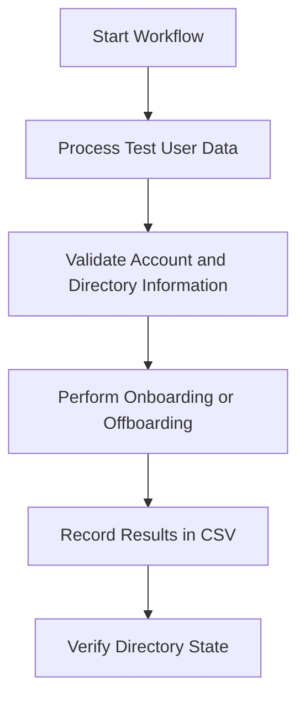

# Active Directory PowerShell Automation

## Overview

This project included PowerShell automation for Active Directory user onboarding and offboarding in an isolated Windows Server 2022 lab.

The goal was to reduce repetitive administrative work, standardize account management, and maintain an audit trail of changes.

## Environment

| Component | Description |
| --- | --- |
| Domain | corp.northstarlab.test |
| Domain Controller | DC01 |
| Directory Service | Active Directory Domain Services |
| Automation | Windows PowerShell and Active Directory module |
| Audit Output | CSV files |

## User Onboarding

The onboarding workflow automated administrative tasks associated with creating and preparing Active Directory user accounts.

Documented capabilities included:

- Creating accounts with standardized attributes.
- Placing accounts in the appropriate organizational units.
- Assigning department-based security group membership.
- Producing structured audit output.

## User Offboarding

The offboarding workflow automated account deactivation and related directory administration.

Documented capabilities included:

- Disabling Active Directory accounts.
- Applying standardized offboarding behavior.
- Recording administrative actions in CSV audit output.

## Automation Workflow

This diagram illustrates the administrative workflow rather than reproducing the exact original script control flow.

## Validation

Historical notes describe onboarding and offboarding testing, but the original script contents and complete execution logs are not available in this repository. A screenshot shows a zero-byte offboarding script file; that image is **not** evidence of a working script.

The following checks are appropriate to repeat and capture before claiming a verified automation run:

- Checking directory account attributes and placement.
- Reviewing security group membership.
- Confirming account disablement behavior.
- Reviewing structured CSV audit records.

## Skills Demonstrated

- Active Directory administration.
- PowerShell scripting.
- User lifecycle management.
- Security group management.
- Administrative automation.
- Audit logging.
- Configuration validation.

## Source Code Status

The original onboarding and offboarding script contents have not yet been recovered for this public repository.

Future additions will include sanitized scripts and sample data, with testing status clearly identified.

## Future Improvements

- Add input validation and error handling tests.
- Implement a safe simulation mode.
- Add structured error reporting.
- Publish sanitized example input and output.
- Expand automated validation and reporting.

## Documentation Note

This document describes work recorded in the September 2026 sanitized technical portfolio. It does not claim that newly published example scripts are identical to the original lab scripts.
