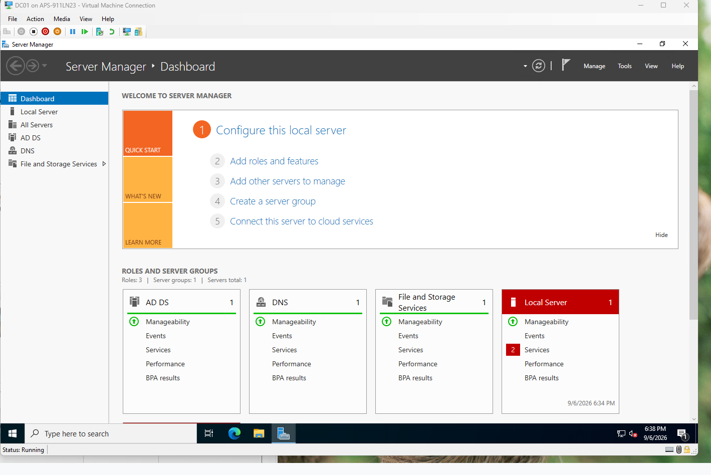
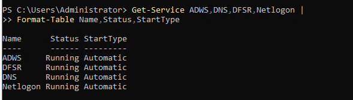
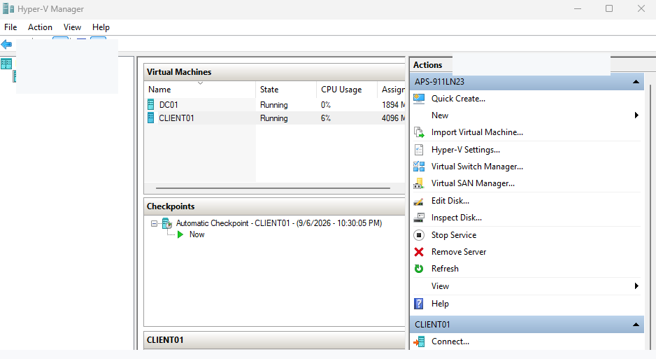
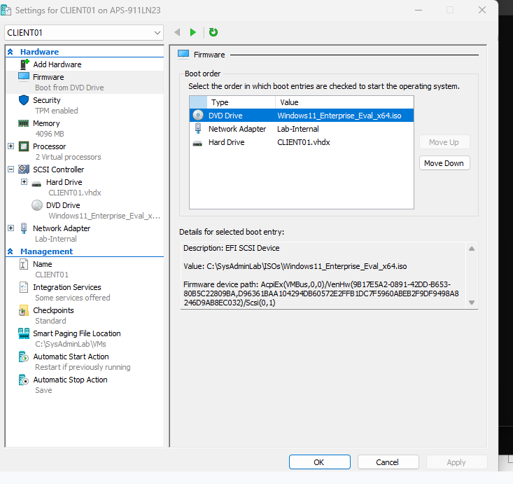
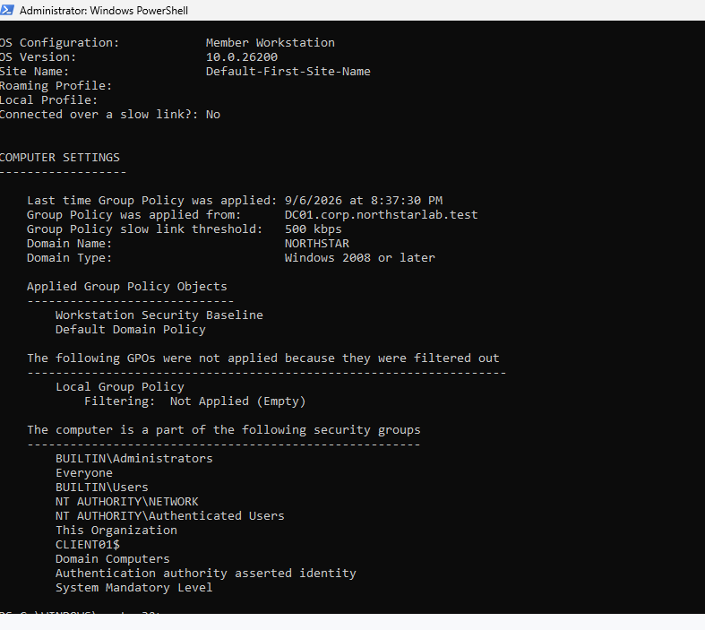
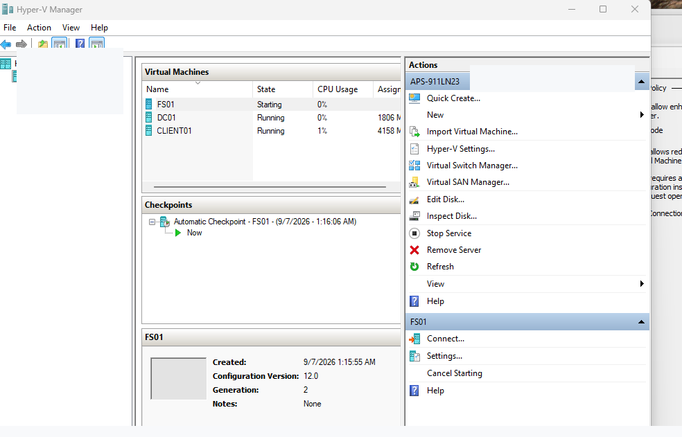
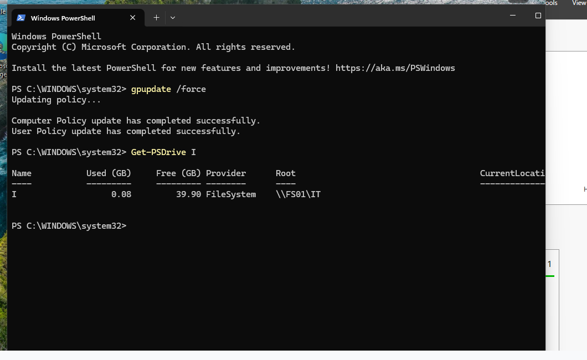
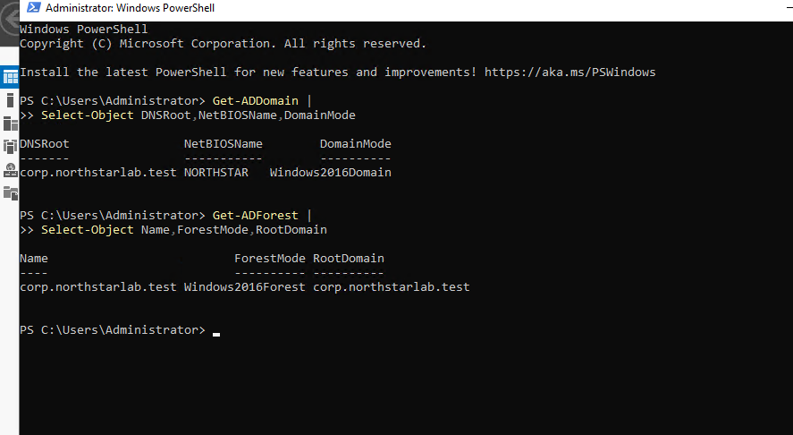
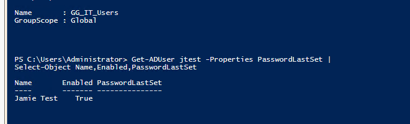

# windows server active directory lab — Published Screenshot Gallery

These images were uploaded by the lab owner. Captions describe the observed evidence without implying production readiness or completed validation that the images do not establish. **Publication does not mean a new independent full-resolution privacy audit has been completed.** If any image contains a sensitive identifier, remove it from GitHub and its history as appropriate.

## 1. Server Manager roles

Server Manager interface; exact role installation and configuration require corroborating evidence.

## 2. Windows services

Service status at the time of capture; not a longitudinal health check.

## 3. Hyper-V running VMs

VM running state, not guest application health.

## 4. DNS Manager

DNS configuration view; resolution success requires a query result.

## 5. Group Policy result

Policy-related output; interpret only visible settings.

## 6. Hyper-V file server

File-server VM context; does not establish share permissions.

## 7. Group Policy refresh and mapped drive

PowerShell shows policy refresh and mapped T: drive to \\FS01\IT.

## 8. Active Directory domain and forest

PowerShell domain/forest query output.

## 9. Active Directory user and group

Group and user queries; not a complete automation execution.

## Evidence boundaries

Screenshots of configurations, inventories, report-only evaluations, pending states, or command attempts must not be described as end-to-end successful deployments. Original unredacted archives are not intended for public release.
