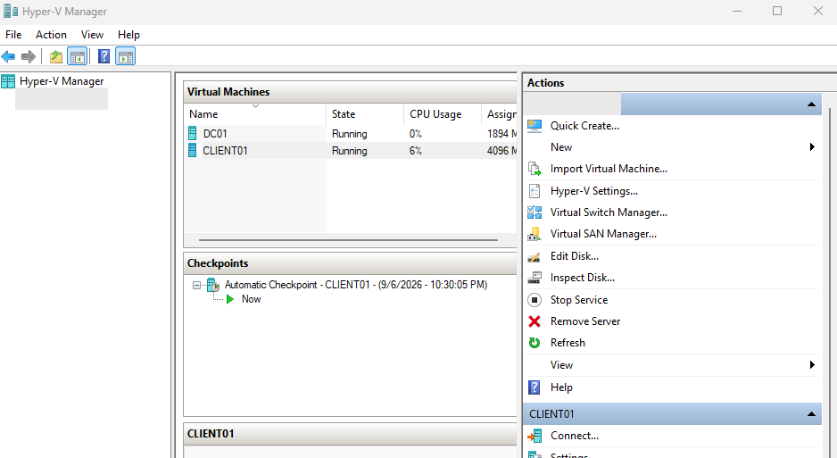
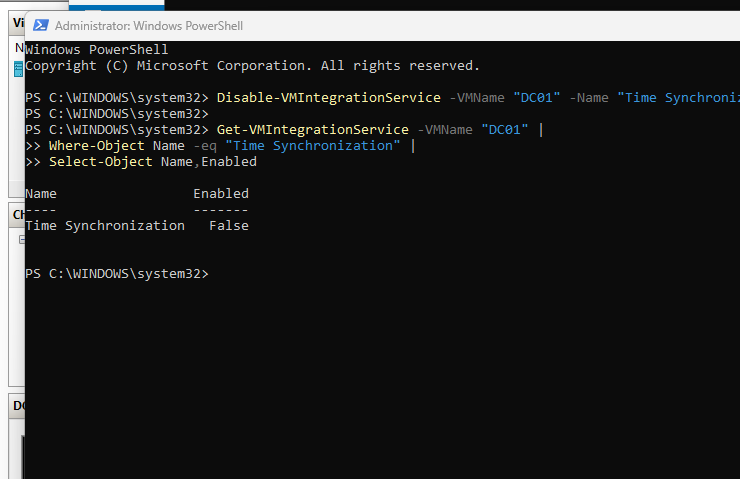
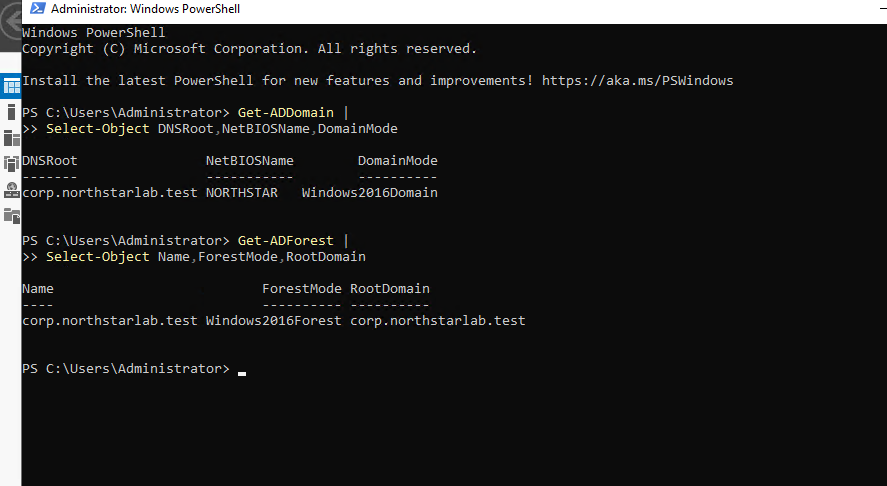
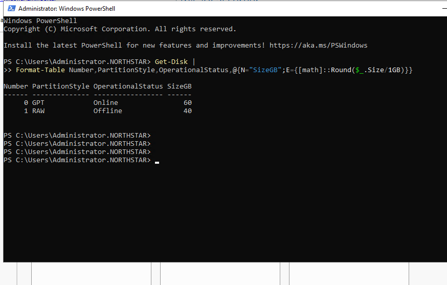
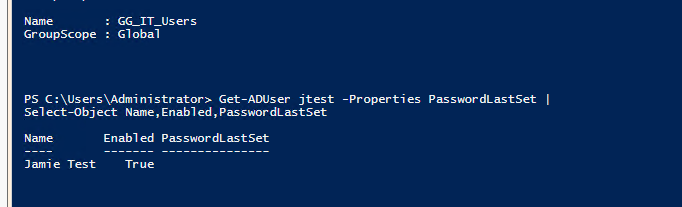
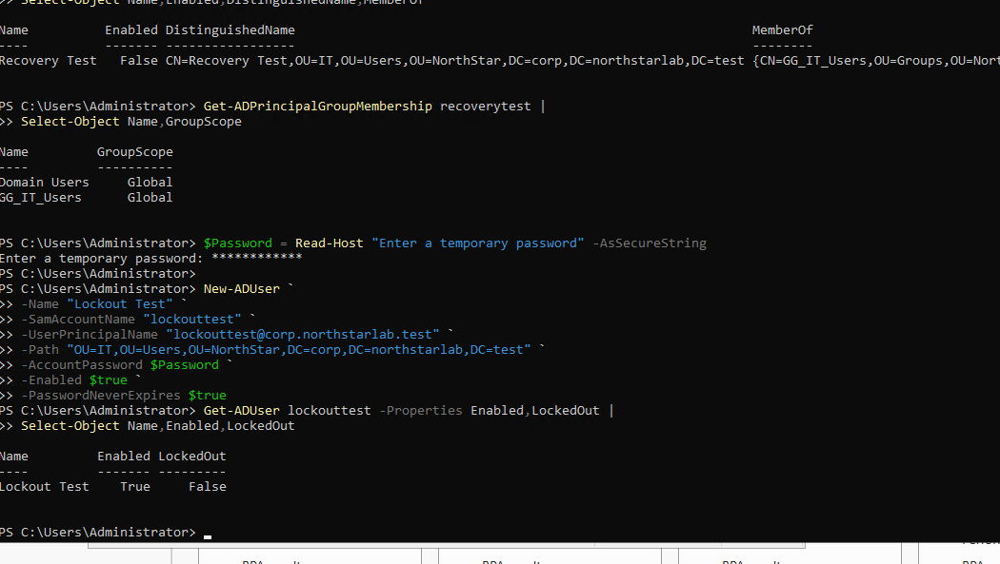
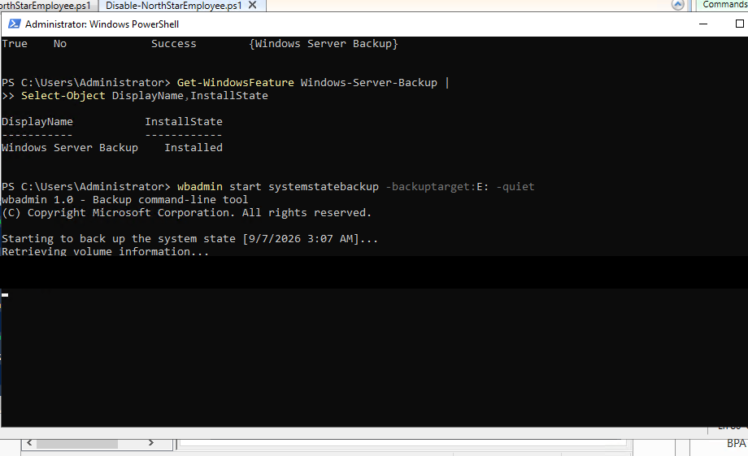
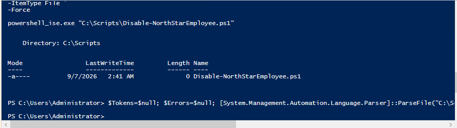

# Windows Server Lab — Screenshot Evidence Gallery

Eight screenshots were selected and privately reviewed for redaction. All eight sanitized PNG images are now hosted in the repository's `evidence/` folder. The screenshots document specific observations, not a claim of production readiness.

| # | Intended image filename | Visible result | Evidence limitation |
|---|---|---|---|
| 1 | `01_HyperV_Running_VMs.png` | Hyper-V Manager shows DC01 and CLIENT01 in Running state | Does not establish guest OS or domain health |
| 2 | `02_HyperV_Time_Sync.png` | PowerShell reports DC01 Hyper-V Time Synchronization integration service `Enabled: False` | Does not establish a correct domain time hierarchy |
| 3 | `03_AD_Domain_Forest.png` | `Get-ADDomain` and `Get-ADForest` return `corp.northstarlab.test` and domain/forest mode information | Does not demonstrate a domain health or security audit |
| 4 | `04_Disk_Inventory.png` | `Get-Disk` shows an online GPT disk and an offline RAW disk | Inventory only; not proof of storage configuration |
| 5 | `05_AD_User_Group.png` | PowerShell displays `GG_IT_Users` and an enabled fictional test user | Does not prove membership in the displayed group |
| 6 | `06_Account_Lockout_Test.png` | PowerShell shows test-user creation, group-membership inspection, and `LockedOut: False` | **Not proof of a successful lockout test** |
| 7 | `07_Backup_Initiation.png` | Windows Server Backup is installed and `wbadmin start systemstatebackup` has begun | **Not proof that backup completed or restored successfully** |
| 8 | `08_PowerShell_Script_Inspection.png` | A PowerShell script filename and parsing-related commands appear in the shell | **Not proof of successful script execution** |

## Security and privacy

The selected copies were cropped or redacted to reduce host, identifier and backup-volume exposure. Fictional lab account names and the lab-only domain remain visible for context. The images were cropped/redacted and reviewed prior to upload, but public GitHub content can be copied or cached; report any remaining exposure immediately. Original archives and unsanitized screenshots must remain private.

## Screenshot gallery

Each image is from the lab and is accompanied by its evidence boundary.

### 1. Hyper-V Manager — DC01 and CLIENT01 running

The VMs are shown as running; this does not verify guest or domain health.

### 2. Hyper-V time synchronization setting

The DC01 integration service reports disabled; domain time hierarchy is not validated by this screenshot.

### 3. Active Directory domain and forest query

PowerShell reports the lab domain and forest functional levels.

### 4. Disk inventory

An online GPT disk and offline RAW disk are shown; no storage deployment success is implied.

### 5. AD group and test user

A lab group and enabled test user are visible; membership is not proven.

### 6. Test account and lockout status

The displayed account reports `LockedOut: False`; do not describe as a successful lockout.

### 7. Windows Server Backup initiation

The backup was started; completion or recovery is not established.

### 8. PowerShell script inspection

A script path and inspection commands are visible; execution success is not established.

